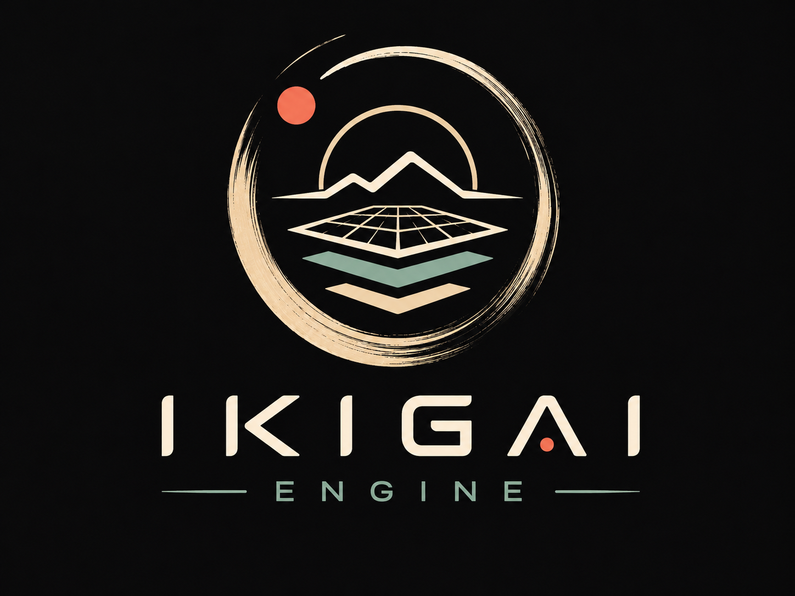
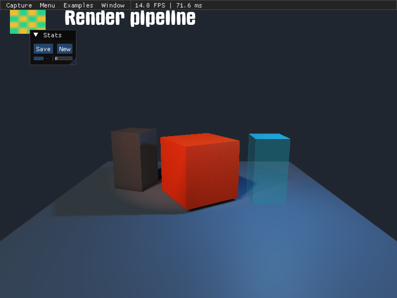
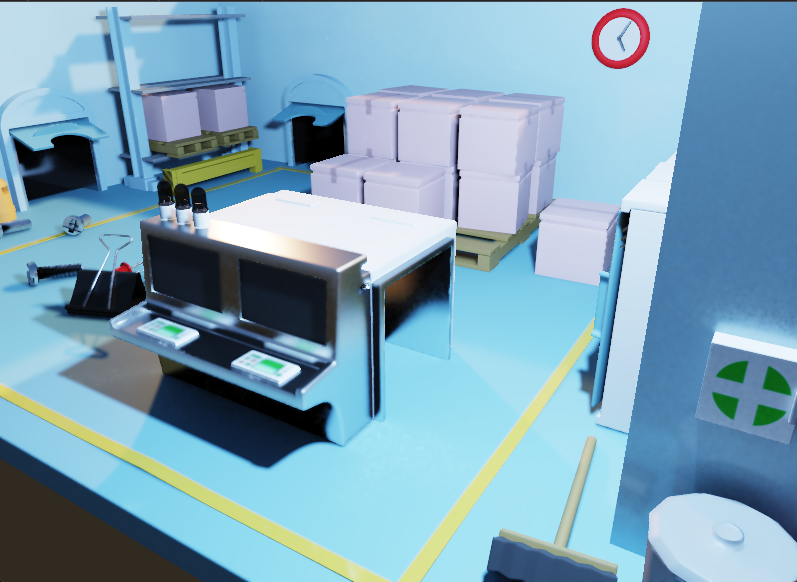
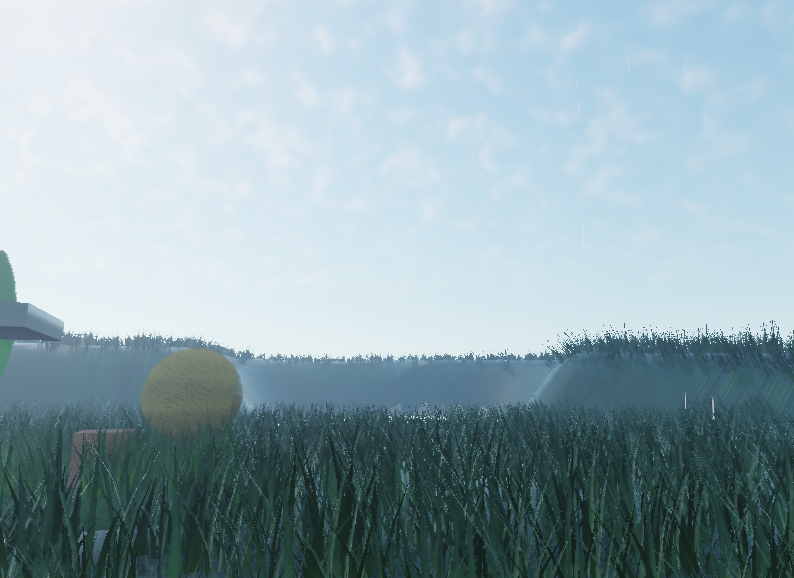
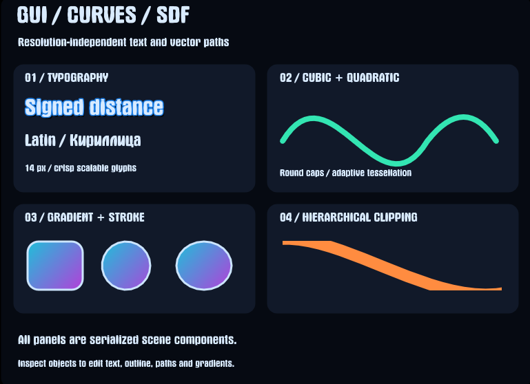
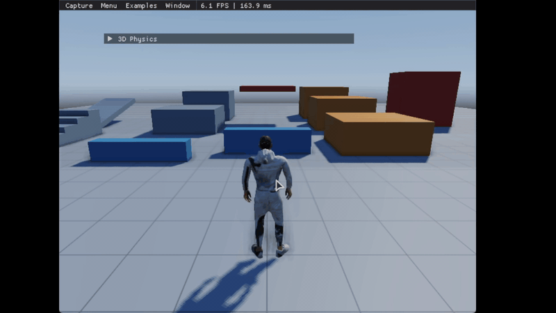
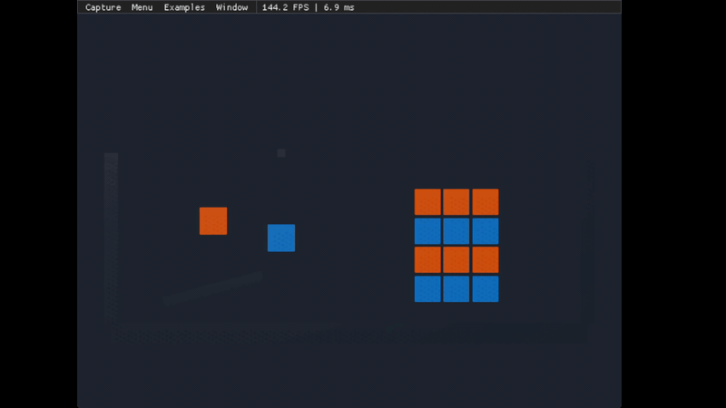
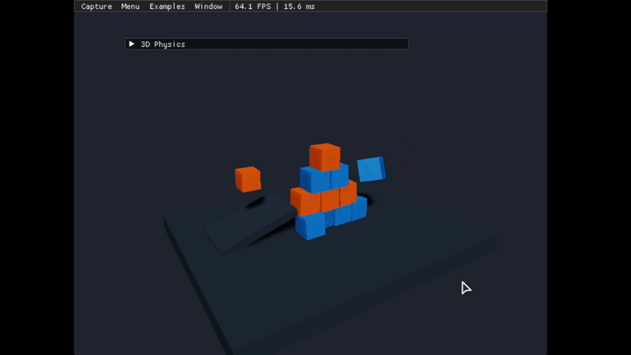
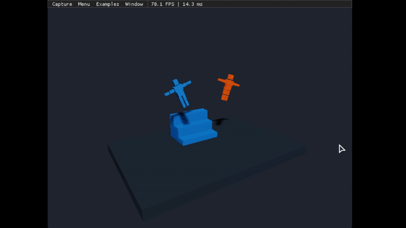

<p align="center">
  
</p>

# Ikigai Engine

Ikigai Engine is a cross-platform C++20 game engine and a learning project for real-time rendering, simulation, and engine architecture. Explore the implementation, open a demo scene in the built-in editor, or swap its rendering pipeline to see how the frame changes.

[Quick start](#quick-start) · [Features](#features) · [Platforms](#platforms) · [Source guide](#source-guide) · [Русский](README.ru.md)

## CI

[](https://github.com/J-CITY/IkigaiEngine/actions/workflows/renderer-core.yml?query=branch%3Aecs)
[](https://github.com/J-CITY/IkigaiEngine/actions/workflows/additional-platforms.yml?query=branch%3Aecs)

Additional platform builds run on demand.

## Quick start

You’ll need Git, CMake 3.22+, a C++20 toolchain, and internet access for the initial dependency and asset setup. On Windows, install Visual Studio 2022 with the **Desktop development with C++** workload.

```sh
git clone --recurse-submodules https://github.com/J-CITY/IkigaiEngine.git
cd IkigaiEngine
```

From the repository root, the following commands build the OpenGL version and open the vector UI demo.

```powershell
.\run.cmd run_vs.py -p win -g opengl --build -t Release
.\out\windows\Release\IkigaiEngine.exe --render-backend=opengl --scene /scenes/gui-demo.json
```

On Linux, use `sh ./run.sh run_vs.py -p linux -g opengl --build -t Release`. On macOS, use `sh ./run.sh run_vs.py -p mac -g metal --build -t Release`. The launchers prepare the project’s locked Python environment, platform dependencies, and content.

Open **Menu → Scenes** in the editor to switch between demos. Run the executable with `--help` for runtime options, or pass `run_vs.py --help` to the launcher for build options.

<details>
<summary><strong>Build options and CMake presets</strong></summary>

With the platform dependencies already prepared, configure and build directly with CMake. This Windows example enables Vulkan and 2D physics.

```powershell
cmake --preset windows -DUSE_OPENGL=OFF -DUSE_VULKAN=ON -DUSE_PHYSICS_2D=ON
cmake --build --preset windows-release --target IkigaiEngine
```

The default build and output directories are `build/<platform>/` and `out/<platform>/<configuration>/`. Use `--list-presets` to list the launcher presets, `-DNAME=VALUE` to override CMake options, and `--skip-setup` to use an environment you prepared yourself. The `core-windows`, `core-linux`, and `core-mac` presets build standalone libraries without a graphics SDK.

[CMake presets](CMakePresets.json) · [Feature defaults](cmake/EngineOptions.cmake)

</details>

## Features

Expand any feature for a short description, a source or demo link, and a preview where available. Availability depends on the build options, graphics backend, and device capabilities.

### Rendering

<details>
<summary><strong>Data-driven render pipelines and render graph</strong></summary>

Choose a JSON pipeline per scene or override it with `--pipeline`. The render graph compiles pass dependencies and resource lifetimes, with support for transient resource aliasing.

[Example pipeline](assets/engine/renderPipeline/migrated.json) · [Graph compiler](src/engine/renderModule/renderGraph/renderGraphCompiler.h)



</details>

<details>
<summary><strong>Forward and deferred shading, PBR materials, and shadows</strong></summary>

Use forward or deferred rendering with physically based materials, image-based lighting, and shadow maps. Material and shader assets let a scene use custom shading.

[PBR material descriptor](src/engine/renderModule/materials/pbrMaterialDescriptor.h) · [Lighting pipeline](assets/engine/renderPipeline/lighting-demo.json)

</details>

<details>
<summary><strong>Hybrid ray tracing</strong></summary>

Combine rasterized geometry with hardware ray-traced shadows, ambient occlusion, reflections, and diffuse global illumination on supported Vulkan and DirectX 12 devices. The full Pica Pica demo uses a ray-tracing-capable Vulkan GPU and the desktop demo assets.

[Pica Pica demo notes](assets/game/scenes/pica-pica-demo.md) · [Ray tracing implementation](src/engine/renderModule/gameRayTracing.cpp)



</details>

<details>
<summary><strong>Screen-probe global illumination</strong></summary>

Estimate diffuse indirect light with screen-space probes and temporal filtering. Experimental paths use ray queries, irradiance probes, or cooked signed distance fields, depending on the pipeline.

[Screen-probe settings](src/engine/renderModule/renderGraph/screenProbeSettings.h)

</details>

<details>
<summary><strong>GPU-driven rendering</strong></summary>

GPU scene submission on Windows Vulkan and DirectX 12 includes culling and indirect draws for regular meshes.

[GPU scene](src/engine/renderModule/gpuScene.h)

</details>

<details>
<summary><strong>Virtual geometry</strong></summary>

Cook meshes into clustered `.vmesh` assets and explore screen-space LOD selection, occlusion culling, and page streaming.

[Virtual geometry module](src/engine/virtualGeometryModule)

</details>

<details>
<summary><strong>Post-processing</strong></summary>

Pipeline passes include HDR tone mapping, bloom, SSAO, motion blur, light shafts, and anti-aliasing.

[Post-processing pipeline](assets/engine/renderPipeline/migrated-all-post.json)

</details>

<details>
<summary><strong>Upscaling and frame generation</strong></summary>

Windows Vulkan and DirectX 12 builds can opt into NVIDIA DLSS and AMD FSR with the corresponding SDKs and hardware. The launcher exposes independent `--dlss-sr`, `--fsr-sr`, `--dlss-fg`, and `--fsr-fg` flags.

[Upscaler integration](cmake/Upscalers.cmake)

</details>

<details>
<summary><strong>Terrain, atmosphere, and weather</strong></summary>

Generate tiled terrain with level of detail and instanced grass. The environment demo combines a pond, sky, clouds, and rain with live controls for time of day, wind, and weather.

[Environment demo scene](assets/game/scenes/environment-demo.json) · [Surface module](src/engine/surfaceModule)



</details>

<details>
<summary><strong>Vector graphics and in-game UI</strong></summary>

Compose scene UI with scalable SDF text, Bézier curves, gradients, strokes, and hierarchical clipping.

[Vector UI demo scene](assets/game/scenes/gui-demo.json) · [Vector graphics module](src/engine/vectorGraphicsModule)



</details>

### Simulation and gameplay

<details>
<summary><strong>Skeletal animation and character traversal</strong></summary>

Blend skeletal clips with blend spaces and state graphs. The third-person desktop demo uses the character motor and animation system for locomotion, vaulting, and mantling.

[Skeletal animation module](src/engine/skeletalModule) · [Third-person demo scene](assets/game/third-person-traversal-demo.json)



</details>

<details>
<summary><strong>2D physics</strong></summary>

The optional 2D module simulates rigid bodies, contacts, and constraints, and includes solvers for soft bodies, cloth, and particle fluids. Enable it with `-DUSE_PHYSICS_2D=ON` to open the orthographic stacking demo.

[2D physics demo scene](assets/game/scenes/physics-2d-demo.json) · [2D physics module](src/engine/physics2dModule)



</details>

<details>
<summary><strong>3D physics</strong></summary>

The 3D physics module solves rigid-body contacts and constraints and includes solvers for soft bodies, cloth, and particle fluids. It is enabled by default with `USE_PHYSICS_3D`.

[3D physics demo scene](assets/game/scenes/physics-3d-demo.json) · [3D physics module](src/engine/physicsModule)



</details>

<details>
<summary><strong>Ragdolls</strong></summary>

Drive a skinned character from constrained 3D rigid bodies. Ragdoll components can switch a character from animation to simulation.

[Ragdoll demo scene](assets/game/scenes/ragdoll-demo.json) · [Ragdoll system](src/engine/coreModule/ecs/systems/ragdollSystem.cpp)



</details>

<details>
<summary><strong>Destructible meshes</strong></summary>

Slice supported meshes at runtime and turn detached pieces into physics bodies. The runtime supports plane cuts, prepared concave meshes, and support anchors.

[Destruction module](src/engine/destructionModule)

</details>

<details>
<summary><strong>Particles</strong></summary>

Emit billboards or mesh particles in world space and use screen-space emitters for 2D effects.

[Particle demo scene](assets/game/scenes/particles-demo.json) · [Particle module](src/engine/particleModule)

</details>

<details>
<summary><strong>Behavior trees and input actions</strong></summary>

Build AI behaviors with tasks, decorators, services, and a blackboard. Map player controls to named actions through an input asset.

[AI module](src/engine/aiModule) · [Default input bindings](assets/engine/Configs/input.input)

</details>

### Engine and tools

<details>
<summary><strong>ECS, scenes, prefabs, and reflection</strong></summary>

Organize runtime behavior in entities, components, and systems. Serialize scene hierarchies, save reusable subtrees as prefabs, and inspect reflected properties in tooling.

[Scene manager](src/engine/sceneModule/sceneManager.h) · [ECS example](src/EcsDemo.h) · [Reflection example](src/ReflectionDemo.h)

</details>

<details>
<summary><strong>In-engine editor</strong></summary>

The ImGui editor provides a scene hierarchy, component inspector, transform gizmos, material tools, and prefab workflows with undo and redo.

[Editor module](src/engine/editorModule)

</details>

<details>
<summary><strong>Lua, IkigaiScript, and JSON tool windows</strong></summary>

Attach Lua or IkigaiScript components to scenes. Define editor and debug windows in JSON with C++, Lua, or IkigaiScript controllers. In builds with JSON views enabled, **F8** opens the window manager.

[Scripting module](src/engine/scriptModule) · [JSON view runtime](src/engine/imguiViewsModule)

</details>

<details>
<summary><strong>Spatial audio</strong></summary>

SoLoud provides 2D and positional 3D playback, streamed audio, and mixer buses.

[Audio module](src/engine/audioModule)

</details>

<details>
<summary><strong>Virtual file system, content packs, and player profiles</strong></summary>

The virtual file system mounts core assets and feature packs under shared paths. The content service handles ZIP packages and updates, and player profiles store writable data separately from mounted assets.

[Content service](src/engine/resourceModule/contentService.h) · [Player profiles](src/engine/resourceModule/playerProfile.h) · [Asset sync tool](utils/assets/sync_assets.py)

</details>

<details>
<summary><strong>Networking</strong></summary>

Use TCP and UDP on native targets and HTTP or WebSocket transports on supported native and browser builds. Native HTTPS and WSS use the optional OpenSSL integration.

[Network module](src/engine/networkModule) · [Network build options](cmake/Networking.cmake)

</details>

<details>
<summary><strong>Meta Quest and OpenXR</strong></summary>

The Quest application uses OpenXR for immersive rendering and controller input. The launcher builds a native APK through Gradle.

[Quest build](cmake/quest/CMakeLists.txt) · [OpenXR input](src/engine/windowModule/window/oxrInput.cpp)

</details>

<details>
<summary><strong>Profiling, logging, and frame capture</strong></summary>

Inspect frame timings and logs in the editor. Capture a PNG from the frame or a named render target through the screenshot service. A standalone Windows crash reporter is available as an optional tool.

[Profiler](src/engine/profilerModule) · [Screenshot service](src/engine/captureModule) · [Crash reporter](testModule/tools/crashReporter)

</details>

## Platforms

| Target | Graphics APIs | Launcher platform |
| --- | --- | --- |
| Windows | OpenGL, Vulkan, DirectX 12 | `win` |
| Linux | OpenGL, Vulkan | `linux` |
| macOS | Metal, Vulkan via MoltenVK, OpenGL | `mac` |
| iOS | Metal, OpenGL ES | `ios` |
| Android | OpenGL ES 3.0 / 3.1 / 3.2 | `android` |
| Meta Quest | OpenGL ES 3.0 / 3.1 / 3.2 with OpenXR | `quest` |
| Web | WebGL 2 via Emscripten / WebAssembly | `web` |

Pass `-p` to select a launcher platform and `-g` to include graphics backends. At runtime, `--render-backend=<backend>` selects a compiled backend and overrides the setting in `/Configs/render.json`. Android and Quest builds accept `--abi` and `--esVer`. For Web, use `--run` to open the built version with Emscripten’s local runner.

## Source guide

| Path | What you’ll find |
| --- | --- |
| [`src/engine/`](src/engine) | Engine modules, from rendering and ECS to physics and tooling |
| [`assets/game/scenes/`](assets/game/scenes) | Demo scenes you can open in the editor or with `--scene` |
| [`assets/`](assets) and [`assets_packs/`](assets_packs) | Core and game assets, plus platform-specific feature and demo packs |
| [`cmake/modules/`](cmake/modules) | Explicit source manifests for engine modules and graphics backends |
| [`testModule/`](testModule) | Optional tests and tools, including the separate Windows crash reporter |

When reporting a bug, include the platform, graphics backend, and scene or steps needed to reproduce it. Format C++ changes with the repository’s [`.clang-format`](.clang-format) and register new engine files in the corresponding CMake module manifest.

## Thanks

Thanks to the authors of these projects:

- [diharaw/animation-system](https://github.com/diharaw/animation-system)
- [diharaw/hybrid-rendering](https://github.com/diharaw/hybrid-rendering)
- [MxEngine](https://github.com/asc-community/MxEngine)
- [im-neo-sequencer](https://gitlab.com/GroGy/im-neo-sequencer)
- [Overload](https://github.com/Overload-Technologies/Overload)
- [skygfx](https://github.com/okhmanyuk-ev/skygfx)
- [mtrebi/memory-allocators](https://github.com/mtrebi/memory-allocators) — memory allocator implementations.
- [GLM](https://github.com/g-truc/glm), [webgl-noise](https://github.com/ashima/webgl-noise) — the basis for the simplex noise implementation.

## License

Ikigai Engine is released under the [MIT License](LICENSE).
