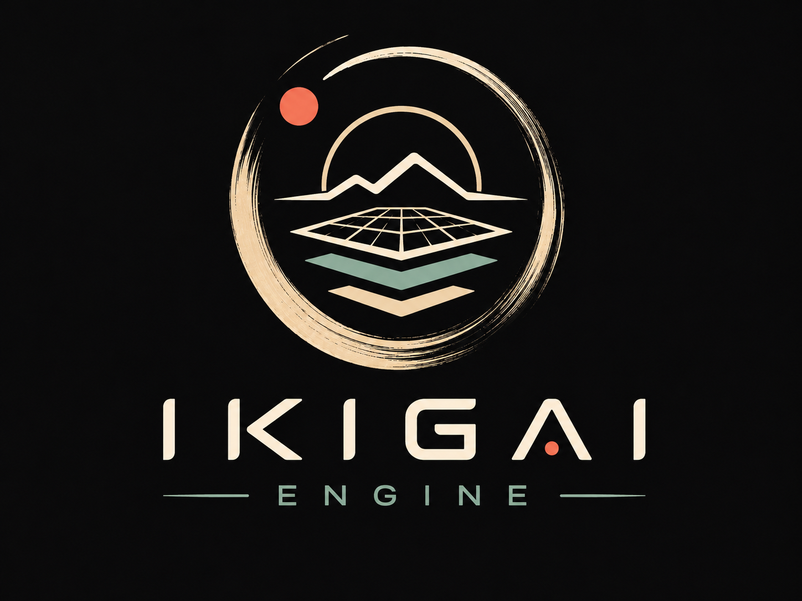
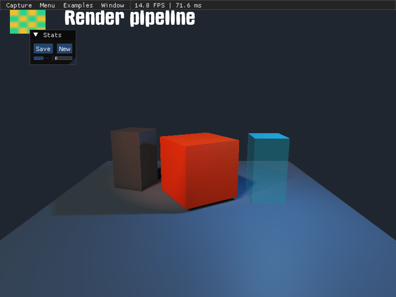
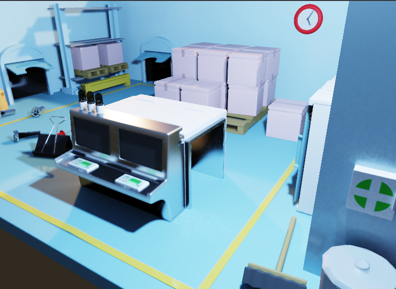
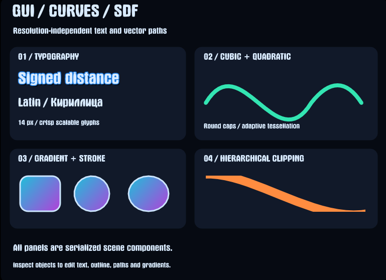
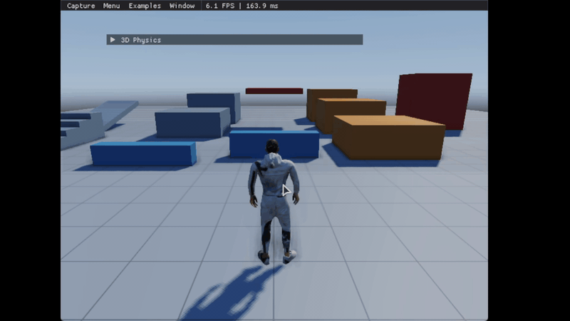
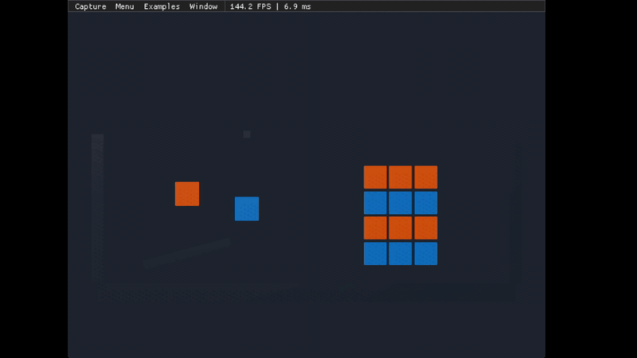
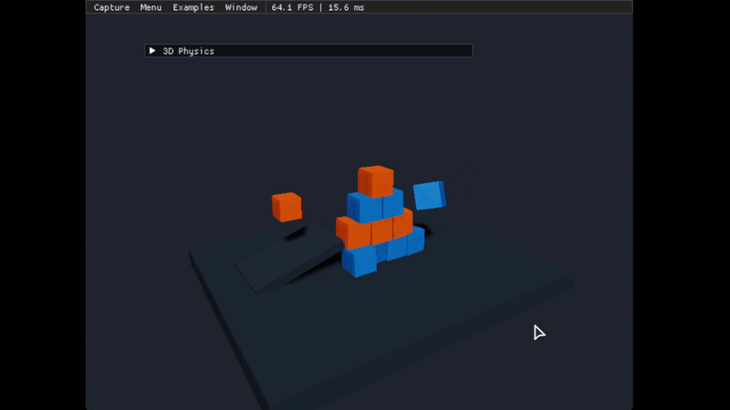
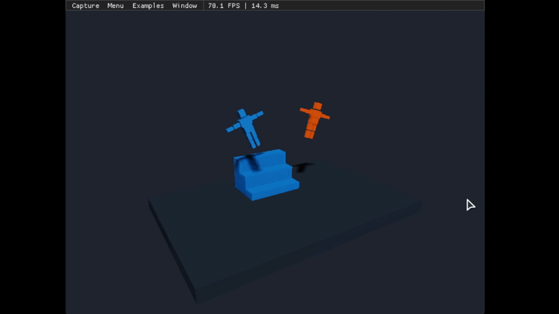

<p align="center">
  
</p>

# Ikigai Engine

Ikigai Engine — кроссплатформенный игровой движок на C++20 и учебный проект по графике реального времени, симуляции и архитектуре движков. Можно изучить реализацию, открыть демонстрационную сцену во встроенном редакторе или сменить конвейер рендеринга и посмотреть, как изменится кадр.

[Быстрый старт](#быстрый-старт) · [Возможности](#возможности) · [Платформы](#платформы) · [Структура репозитория](#структура-репозитория) · [English](README.md)

## Быстрый старт

Понадобятся Git, CMake 3.22+, компилятор с поддержкой C++20 и интернет для первоначальной загрузки зависимостей и ресурсов. На Windows установите Visual Studio 2022 с рабочей нагрузкой **«Разработка классических приложений на C++»**.

```sh
git clone --recurse-submodules https://github.com/J-CITY/IkigaiEngine.git
cd IkigaiEngine
```

Эти команды из корня репозитория собирают версию с OpenGL и открывают демо векторного интерфейса.

```powershell
.\run.cmd run_vs.py -p win -g opengl --build -t Release
.\out\windows\Release\IkigaiEngine.exe --render-backend=opengl --scene /scenes/gui-demo.json
```

На Linux используйте `sh ./run.sh run_vs.py -p linux -g opengl --build -t Release`. На macOS используйте `sh ./run.sh run_vs.py -p mac -g metal --build -t Release`. Скрипты запуска подготавливают Python-окружение с зафиксированными версиями пакетов, платформенные зависимости и ресурсы.

Для переключения между демо откройте **Menu → Scenes** в редакторе. Запустите движок с `--help`, чтобы увидеть параметры запуска, или передайте скрипту запуска `run_vs.py --help`, чтобы увидеть параметры сборки.

<details>
<summary><strong>Параметры сборки и пресеты CMake</strong></summary>

Когда платформенные зависимости подготовлены, проект можно настроить и собрать напрямую через CMake. В этом примере для Windows включены Vulkan и 2D-физика.

```powershell
cmake --preset windows -DUSE_OPENGL=OFF -DUSE_VULKAN=ON -DUSE_PHYSICS_2D=ON
cmake --build --preset windows-release --target IkigaiEngine
```

По умолчанию файлы сборки находятся в `build/<platform>/`, а её результаты — в `out/<platform>/<configuration>/`. Используйте `--list-presets` для просмотра доступных пресетов, `-DNAME=VALUE` для изменения параметров CMake и `--skip-setup` для работы с уже подготовленным окружением. Пресеты `core-windows`, `core-linux` и `core-mac` собирают самостоятельные библиотеки без графического SDK.

[Пресеты CMake](CMakePresets.json) · [Параметры по умолчанию](cmake/EngineOptions.cmake)

</details>

## Возможности

Раскройте нужный раздел, чтобы прочитать описание, перейти к исходникам или демо и посмотреть кадры, если они есть. Доступность функций зависит от параметров сборки, графического бэкенда и возможностей устройства.

### Рендеринг

<details>
<summary><strong>Настраиваемые конвейеры и граф рендеринга</strong></summary>

Для каждой сцены можно выбрать конвейер в JSON или переопределить его через `--pipeline`. Граф рендеринга вычисляет зависимости проходов и время жизни ресурсов, поддерживая переиспользование памяти временных ресурсов.

[Пример конвейера](assets/engine/renderPipeline/migrated.json) · [Компилятор графа](src/engine/renderModule/renderGraph/renderGraphCompiler.h)



</details>

<details>
<summary><strong>Прямой и отложенный рендеринг, PBR-материалы и тени</strong></summary>

Прямой и отложенный рендеринг поддерживают физически обоснованные материалы, освещение от окружения и карты теней. Материалы и шейдеры задаются ресурсами, поэтому для сцены можно настроить собственное затенение.

[Дескриптор PBR-материала](src/engine/renderModule/materials/pbrMaterialDescriptor.h) · [Конвейер освещения](assets/engine/renderPipeline/lighting-demo.json)

</details>

<details>
<summary><strong>Гибридная трассировка лучей</strong></summary>

На совместимых устройствах с Vulkan и DirectX 12 растеризация сочетается с аппаратной трассировкой теней, фонового затенения, отражений и диффузного глобального освещения. Для полной версии демо Pica Pica нужны настольный пакет ресурсов и GPU с поддержкой трассировки лучей в Vulkan.

[Описание демо Pica Pica](assets/game/scenes/pica-pica-demo.md) · [Реализация трассировки](src/engine/renderModule/gameRayTracing.cpp)



</details>

<details>
<summary><strong>Глобальное освещение на экранных зондах</strong></summary>

Диффузное непрямое освещение рассчитывается по зондам в экранном пространстве с временной фильтрацией. В зависимости от конвейера экспериментальные режимы используют запросы трассировки лучей, зонды освещённости или подготовленные поля расстояний со знаком.

[Настройки экранных зондов](src/engine/renderModule/renderGraph/screenProbeSettings.h)

</details>

<details>
<summary><strong>GPU-driven рендеринг</strong></summary>

В сборках Windows с Vulkan или DirectX 12 GPU отбирает видимые объекты и формирует косвенные команды отрисовки обычных мешей.

[GPU-сцена](src/engine/renderModule/gpuScene.h)

</details>

<details>
<summary><strong>Виртуальная геометрия</strong></summary>

Модуль разбивает меши на кластеры в формате `.vmesh` и позволяет экспериментировать с выбором LOD по экранной ошибке, отсечением перекрытой геометрии и потоковой загрузкой страниц.

[Модуль виртуальной геометрии](src/engine/virtualGeometryModule)

</details>

<details>
<summary><strong>Постобработка</strong></summary>

Среди проходов постобработки есть тональная компрессия HDR, bloom, SSAO, размытие в движении, световые лучи и сглаживание.

[Конвейер постобработки](assets/engine/renderPipeline/migrated-all-post.json)

</details>

<details>
<summary><strong>Масштабирование и генерация кадров</strong></summary>

В сборках Windows с Vulkan или DirectX 12 можно включить NVIDIA DLSS и AMD FSR при наличии соответствующих SDK и оборудования. В скрипте сборки есть независимые параметры `--dlss-sr`, `--fsr-sr`, `--dlss-fg` и `--fsr-fg`.

[Интеграция масштабирования](cmake/Upscalers.cmake)

</details>

<details>
<summary><strong>Ландшафт, атмосфера и погода</strong></summary>

Ландшафт делится на участки с разными уровнями детализации, а трава рисуется инстансами. В демо окружения есть водоём, небо, облака и дождь. Время суток, ветер и погоду можно менять прямо во время работы сцены.

[Демо окружения](assets/game/scenes/environment-demo.json) · [Модуль поверхностей](src/engine/surfaceModule)

</details>

<details>
<summary><strong>Векторная графика и игровой интерфейс</strong></summary>

Интерфейс собирается из компонентов сцены и поддерживает масштабируемый SDF-текст, кривые Безье, градиенты, обводки и иерархическое отсечение.

[Демо векторного интерфейса](assets/game/scenes/gui-demo.json) · [Модуль векторной графики](src/engine/vectorGraphicsModule)



</details>

### Симуляция и игровой процесс

<details>
<summary><strong>Скелетная анимация и перемещение персонажа</strong></summary>

Клипы скелетной анимации смешиваются в blend spaces и переключаются графами состояний. Настольное демо от третьего лица использует контроллер персонажа и систему анимации для передвижения, перепрыгивания препятствий и подтягивания на уступы.

[Модуль скелетной анимации](src/engine/skeletalModule) · [Демо-сцена от третьего лица](assets/game/third-person-traversal-demo.json)



</details>

<details>
<summary><strong>Двумерная физика</strong></summary>

Модуль 2D-физики рассчитывает контакты и ограничения твёрдых тел, а также поддерживает симуляцию мягких тел, ткани и жидкостей на частицах. Включите `-DUSE_PHYSICS_2D=ON`, чтобы открыть демо со стопкой тел в ортографической проекции.

[Демо 2D-физики](assets/game/scenes/physics-2d-demo.json) · [Модуль 2D-физики](src/engine/physics2dModule)



</details>

<details>
<summary><strong>Трёхмерная физика</strong></summary>

Модуль 3D-физики рассчитывает контакты и ограничения твёрдых тел и поддерживает симуляцию мягких тел, ткани и жидкостей на частицах. По умолчанию он включён через `USE_PHYSICS_3D`.

[Демо 3D-физики](assets/game/scenes/physics-3d-demo.json) · [Модуль 3D-физики](src/engine/physicsModule)



</details>

<details>
<summary><strong>Ragdoll-физика</strong></summary>

Движение скелета персонажа рассчитывается набором связанных трёхмерных тел. Компонент ragdoll позволяет переключить персонажа с анимации на физическую симуляцию.

[Демо ragdoll](assets/game/scenes/ragdoll-demo.json) · [Система ragdoll](src/engine/coreModule/ecs/systems/ragdollSystem.cpp)



</details>

<details>
<summary><strong>Разрушаемые меши</strong></summary>

Поддерживаемые меши можно разрезать во время работы сцены, превращая отделившиеся фрагменты в физические тела. Система поддерживает плоские срезы, подготовленные вогнутые меши и точки опоры.

[Модуль разрушения](src/engine/destructionModule)

</details>

<details>
<summary><strong>Частицы</strong></summary>

Эмиттеры в мировом пространстве создают билборды или частицы с мешами, а эмиттеры в экранном пространстве подходят для двумерных эффектов.

[Демо частиц](assets/game/scenes/particles-demo.json) · [Модуль частиц](src/engine/particleModule)

</details>

<details>
<summary><strong>Деревья поведения и действия ввода</strong></summary>

Поведение ИИ задаётся через задачи, декораторы, сервисы и общую доску данных (blackboard). Клавиши и другие элементы управления привязываются к именованным действиям через ресурс настроек ввода.

[Модуль ИИ](src/engine/aiModule) · [Привязки ввода по умолчанию](assets/engine/Configs/input.input)

</details>

### Движок и инструменты

<details>
<summary><strong>ECS, сцены, префабы и рефлексия</strong></summary>

Логика движка организована в сущности, компоненты и системы. Иерархии сцен сериализуются, поддеревья можно сохранять как переиспользуемые префабы, а рефлексия открывает свойства компонентов для инструментов.

[Менеджер сцен](src/engine/sceneModule/sceneManager.h) · [Пример ECS](src/EcsDemo.h) · [Пример рефлексии](src/ReflectionDemo.h)

</details>

<details>
<summary><strong>Встроенный редактор</strong></summary>

В редакторе на ImGui есть иерархия сцены, инспектор компонентов, манипуляторы трансформаций, редактор материалов и работа с префабами с поддержкой отмены и повтора действий.

[Модуль редактора](src/engine/editorModule)

</details>

<details>
<summary><strong>Lua, IkigaiScript и окна инструментов в JSON</strong></summary>

К сценам можно подключать компоненты на Lua и IkigaiScript. Окна редактора и отладки описываются в JSON, а их контроллеры пишутся на C++, Lua или IkigaiScript. В сборках с поддержкой JSON-окон клавиша **F8** открывает менеджер окон.

[Модуль скриптов](src/engine/scriptModule) · [Модуль JSON-окон](src/engine/uiModule)

</details>

<details>
<summary><strong>Пространственный звук</strong></summary>

SoLoud обеспечивает двумерный и позиционный 3D-звук, потоковое воспроизведение и шины микширования.

[Аудиомодуль](src/engine/audioModule)

</details>

<details>
<summary><strong>Виртуальная файловая система, пакеты ресурсов и профили игроков</strong></summary>

Виртуальная файловая система монтирует базовые ресурсы и пакеты возможностей под общими путями. Сервис доставки контента работает с ZIP-пакетами и обновлениями, а профили игроков хранят изменяемые данные отдельно от смонтированных ресурсов.

[Сервис доставки контента](src/engine/resourceModule/contentService.h) · [Профили игроков](src/engine/resourceModule/playerProfile.h) · [Синхронизация ресурсов](utils/assets/sync_assets.py)

</details>

<details>
<summary><strong>Сеть</strong></summary>

На нативных платформах доступны TCP и UDP, а поддерживаемые нативные и браузерные сборки могут работать с HTTP и WebSocket. Для HTTPS и WSS в нативных сборках используется опциональная интеграция с OpenSSL.

[Сетевой модуль](src/engine/networkModule) · [Параметры сборки сетевого модуля](cmake/Networking.cmake)

</details>

<details>
<summary><strong>Meta Quest и OpenXR</strong></summary>

Версия для Quest использует OpenXR для VR-рендеринга и ввода с контроллеров. Скрипт сборки собирает нативный APK через Gradle.

[Сборка для Quest](cmake/quest/CMakeLists.txt) · [Ввод через OpenXR](src/engine/windowModule/window/oxrInput.cpp)

</details>

<details>
<summary><strong>Профилирование, журнал и захват кадра</strong></summary>

В редакторе можно смотреть тайминги кадра и журнал. Сервис захвата сохраняет кадр или именованную цель рендеринга в PNG. Для Windows есть отдельная опциональная утилита сбора отчётов о сбоях.

[Профилировщик](src/engine/profilerModule) · [Сервис захвата](src/engine/captureModule) · [Утилита сбора отчётов](testModule/tools/crashReporter)

</details>

## Платформы

| Платформа | Графические API | Значение для скрипта сборки |
| --- | --- | --- |
| Windows | OpenGL, Vulkan, DirectX 12 | `win` |
| Linux | OpenGL, Vulkan | `linux` |
| macOS | Metal, Vulkan через MoltenVK, OpenGL | `mac` |
| iOS | Metal, OpenGL ES | `ios` |
| Android | OpenGL ES 3.0 / 3.1 / 3.2 | `android` |
| Meta Quest | OpenGL ES 3.0 / 3.1 / 3.2 с OpenXR | `quest` |
| Web | WebGL 2 через Emscripten / WebAssembly | `web` |

Параметр `-p` задаёт платформу сборки, а `-g` выбирает графические бэкенды, которые войдут в неё. При запуске `--render-backend=<backend>` выбирает один из собранных бэкендов и переопределяет настройку из `/Configs/render.json`. Для Android и Quest можно задать `--abi` и `--esVer`. Для Web параметр `--run` открывает готовую сборку через локальный инструмент Emscripten.

## Структура репозитория

| Путь | Что здесь находится |
| --- | --- |
| [`src/engine/`](src/engine) | Модули движка, включая рендеринг, ECS, физику и инструменты |
| [`assets/game/scenes/`](assets/game/scenes) | Демо-сцены, которые можно открыть в редакторе или через `--scene` |
| [`assets/`](assets) и [`assets_packs/`](assets_packs) | Базовые и игровые ресурсы, платформенные пакеты возможностей и демо |
| [`cmake/modules/`](cmake/modules) | Явные списки исходников модулей и графических бэкендов |
| [`testModule/`](testModule) | Опциональные тесты и инструменты, включая отдельную утилиту сбора отчётов о сбоях на Windows |

В отчёте об ошибке укажите платформу, графический бэкенд и сцену или шаги воспроизведения. Форматируйте изменения в C++ по [`.clang-format`](.clang-format) и добавляйте новые файлы движка в список исходников соответствующего CMake-модуля.

## Лицензия

Ikigai Engine распространяется по [лицензии MIT](LICENSE).
