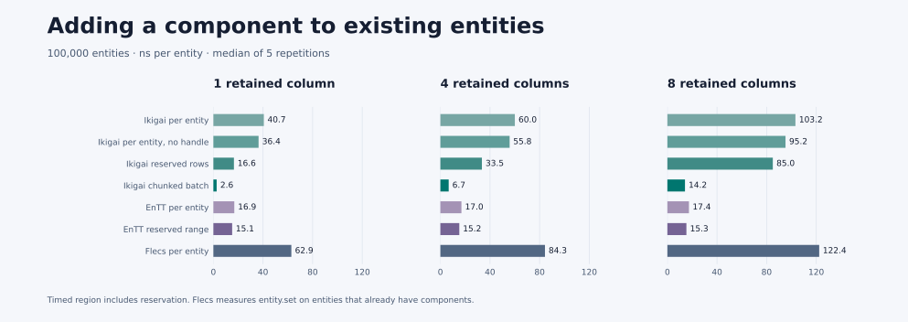
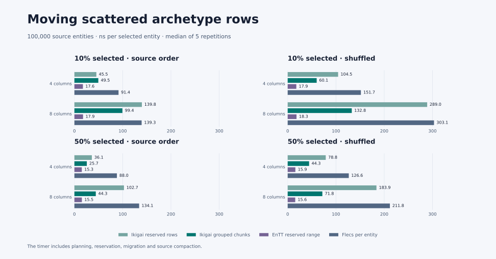

# Ikigai ECS, EnTT и Flecs

На 100 000 сущностей Ikigai тратит 7,3 нс на создание пустой сущности и 7,3 нс на её удаление. В плотном обновлении позиции Ikigai показывает 0,46 нс на сущность, EnTT — 1,53 нс, Flecs без кэша запросов — 0,40 нс.

В сравнении Ikigai запущен с экспериментальной раскладкой SharedRows и гибридным реестром сущностей. Для архетипных компонентов в ней требуется noexcept-перемещение и уничтожение. Все три ECS запускаются из одного Release-бинарника.

## Итерация

Во всех трёх ECS запрос ищет сущности с `Position` и `Velocity` и обновляет обе координаты позиции. Совпадения означают долю сущностей, у которых есть оба компонента. Сценарий с 16 наборами добавляет четыре тега в разных комбинациях. В столбце «Ikigai sparse» позиция хранится в архетипе, а скорость — в sparse-пуле. Для этой конфигурации замерены два сценария с фильтром. У Flecs позиция и скорость хранятся в архетипе.

Медианное время в наносекундах на совпавшую сущность. Меньше — быстрее.

| Сущности | Совпадения | Наборы | Ikigai | Ikigai sparse | EnTT | Flecs | Flecs с кэшем |
|---:|---:|---:|---:|---:|---:|---:|---:|
| 1 000 | 100% | 1 | 0,45 | — | 1,52 | 0,47 | 0,46 |
| 1 000 | 10% | 1 | 0,62 | 1,66 | 1,32 | 1,24 | 1,00 |
| 1 000 | 50% | 1 | 0,48 | 1,52 | 1,29 | 0,57 | 0,51 |
| 1 000 | 100% | 16 | 0,64 | — | 1,53 | 0,84 | 0,77 |
| 10 000 | 100% | 1 | 0,45 | — | 1,66 | 0,40 | 0,40 |
| 10 000 | 10% | 1 | 0,45 | 1,88 | 1,49 | 0,47 | 0,45 |
| 10 000 | 50% | 1 | 0,44 | 1,47 | 1,32 | 0,41 | 0,44 |
| 10 000 | 100% | 16 | 0,48 | — | 1,54 | 0,45 | 0,43 |
| 100 000 | 100% | 1 | 0,46 | — | 1,53 | 0,40 | 0,40 |
| 100 000 | 10% | 1 | 0,45 | 2,55 | 1,57 | 0,40 | 0,44 |
| 100 000 | 50% | 1 | 0,45 | 1,64 | 1,32 | 0,39 | 0,40 |
| 100 000 | 100% | 16 | 0,52 | — | 1,54 | 0,41 | 0,41 |

В Ikigai плотные запросы проходят по непрерывным участкам колонок. В смешанных сценариях ведущим оказывается sparse-пул скоростей. Если запрос содержит одну архетипную и одну sparse-колонку и подходит одна таблица, обе колонки выбираются один раз. Скорость читается из текущего чанка, а запись сущности даёт номер строки позиции. Запрос переиспользует страницу реестра для соседних ID.

В отдельной диагностике на 100 000 сущностей поиск записи по ID с чтением номера строки занимает 1,04 нс при 10% совпадений и 0,89 нс при 50%. Полный смешанный проход в том же прогоне занимает 2,43 и 1,60 нс на совпавшую сущность. Приведены медианы семи повторов.

## Структурные операции

Создание и удаление измеряются на пустых сущностях. В раздельных замерах добавления и снятия дополнительного компонента у сущности уже есть позиция. Целевое хранилище подготавливается вне таймера. В сценарии «цикл» к каждой сущности добавляется и сразу снимается компонент, а одна пара считается двумя операциями. Все числа в наносекундах на операцию.

| Сущности | Операция | Ikigai | EnTT | Flecs |
|---:|---|---:|---:|---:|
| 1 000 | Создать сущность | 7,8 | 18,3 | 20,7 |
| 1 000 | Удалить сущность | 8,8 | 21,6 | 24,6 |
| 1 000 | Добавить компонент | 42,5 | 17,7 | 64,4 |
| 1 000 | Снять компонент | 21,4 | 26,0 | 48,5 |
| 1 000 | Цикл добавления и снятия | 26,8 | 21,4 | 59,4 |
| 10 000 | Создать сущность | 6,8 | 17,2 | 19,3 |
| 10 000 | Удалить сущность | 7,2 | 21,2 | 23,0 |
| 10 000 | Добавить компонент | 41,5 | 17,3 | 61,7 |
| 10 000 | Снять компонент | 18,9 | 25,7 | 46,5 |
| 10 000 | Цикл добавления и снятия | 26,1 | 20,6 | 56,2 |
| 100 000 | Создать сущность | 7,3 | 17,3 | 21,4 |
| 100 000 | Удалить сущность | 7,3 | 21,4 | 22,8 |
| 100 000 | Добавить компонент | 43,2 | 17,4 | 63,4 |
| 100 000 | Снять компонент | 20,4 | 25,7 | 47,5 |
| 100 000 | Цикл добавления и снятия | 26,0 | 20,5 | 54,6 |

При смене состава сущности Ikigai переносит колонки по общему номеру строки и сохраняет поколения компонентов. В таблице у Ikigai измеряется публичный вызов добавления с возвратом handle.

## Реестр сущностей

Обычное создание использует страницы по 256 записей. Загруженные ID сохраняют свои значения. Разреженные записи хранятся в компактной таблице. Уже открытая страница или серия из восьми последовательных ID направляет новые записи в страничный индекс. Записи, уже добавленные в компактную таблицу, остаются на месте.

На 100 000 ID отдельная генерация занимает 3,6 нс на ID. Регистрация 100 000 заранее подготовленных последовательных ID через `World::registerEntity` занимает 3,7 нс на запись. Регистрация 1 000 разреженных ID с шагом 65 537 занимает 34,3 нс на запись. Это медианы отдельного прогона с семью повторами.

На тех же фикстурах прежняя страничная версия регистрировала разреженные ID в 23 раза медленнее. На 1 000, 10 000 и 100 000 обычных сущностей максимальный рост медианы создания или удаления составил 0,8%, в пределах разброса повторов.

Снимки занятых блоков кучи CRT на Windows показывают прирост памяти реестра. Пустой архетип и буфер ID готовы к первому снимку.

| Сценарий | Живые байты после вставки | После удаления всех сущностей |
|---|---:|---:|
| Регистрация 1 000 разреженных ID | 72 543 | 0 |
| Создание 100 000 последовательных ID | 3 222 624 | 2 056 |

Разреженная загрузка занимает в 142 раза меньше живой памяти, чем со страничным индексом. В сценарии с последовательными ID объём совпал с прежней версией. После удаления остаётся только корень страничного индекса.

## Добавление архетипного компонента

В этих сценариях SharedRows добавляет компонент к 100 000 сущностей. У каждой уже есть 1, 4 или 8 колонок. Перед измерением целевой архетип заполняется временными сущностями и очищается. Для замера с ростом прогрев добавляет одну строку, для замера с подготовленной ёмкостью — весь объём.

Медианы в наносекундах на сущность, из отдельных прогонов. Поиск включает чтение записи сущности и выбор прогретого перехода. Перенос с готовым планом включает чтение записи, вставку нового компонента, перенос сохранённых колонок и освобождение исходной строки. Два полных замера вызывают публичный API с возвратом handle.

| Сохраняемых колонок | Поиск цели | Перенос с готовым планом | Полный вызов, готовая ёмкость | Полный вызов, с ростом |
|---:|---:|---:|---:|---:|
| 1 | 3,2 | 17,2 | 40,4 | 44,2 |
| 4 | 3,2 | 31,8 | 50,9 | 59,9 |
| 8 | 3,3 | 61,5 | 80,1 | 94,5 |

В отдельном сценарии с одной операцией на мир первое добавление занимает 763 нс, прогретое — 119 нс. Холодный вызов создаёт целевой архетип и план перехода.

В отдельном структурном прогоне добавление компонента к сущности с позицией занимает 43,0 нс через `addComponent` с возвратом handle и 37,9 нс через `addComponents`.

План связывает исходные колонки с целевыми при первом переходе. Проверка ёмкости сводится к одному порогу таблицы между расширениями. При вставке компонента-значения без слушателей handle использует поколения, полученные в самой операции.

### Аллокации при росте целевого архетипа

Отдельный замер воспроизводит вызовы `reserve` для 100 000 строк. Цель содержит 2, 5 или 9 колонок вместе с добавляемым компонентом. Для непрерывных поколений векторы заранее заполнены до порога роста, поэтому замер включает копирование живых значений. Медианы в наносекундах на будущую строку.

| Сохраняемых колонок | Чанки, free-list | Чанки, heap | Поколения, рост ×1,5 | Поколения, новый шаг |
|---:|---:|---:|---:|---:|
| 1 | 0,88 | 0,55 | 2,07 | 1,68 |
| 4 | 4,19 | 1,12 | 6,84 | 4,37 |
| 8 | 13,44 | 1,95 | 13,03 | 10,89 |

Для девяти целевых колонок по счётчику скопированного диапазона поколения переносят 12,8 МБ за прогон. Чанки SharedRows используют существующий `HeapAllocator` с категорией `Component`. Массивы поколений растут примерно на 50% до порога 4 096 строк. Начиная с этого порога, ёмкость удваивается. Для этой фикстуры итоговая ёмкость поколений составляет 12,43 МБ.

## Пакетное добавление архетипного компонента

В одном вызове к 1 000 или 100 000 существующих сущностей добавляется одинаковый компонент. Целевое хранилище заранее прогревается одной строкой. Таймер включает резервирование и перенос. Медианы пяти повторов приведены в наносекундах на сущность.

| Сущностей | Сохраняемых колонок | Ikigai поштучно | Ikigai поштучно без handle | Ikigai пакет по строкам | Ikigai пакет чанками | EnTT поштучно | EnTT диапазон | Flecs поштучно |
|---:|---:|---:|---:|---:|---:|---:|---:|---:|
| 1 000 | 1 | 40,9 | 36,9 | 14,8 | 3,1 | 17,4 | 15,2 | 61,5 |
| 1 000 | 4 | 54,3 | 51,2 | 28,8 | 4,8 | 17,3 | 15,3 | 83,2 |
| 1 000 | 8 | 76,2 | 72,9 | 46,5 | 7,3 | 17,6 | 15,7 | 120,0 |
| 100 000 | 1 | 40,7 | 36,4 | 16,6 | 2,6 | 16,9 | 15,1 | 62,9 |
| 100 000 | 4 | 60,0 | 55,8 | 33,5 | 6,7 | 17,0 | 15,2 | 84,3 |
| 100 000 | 8 | 103,2 | 95,2 | 85,0 | 14,2 | 17,4 | 15,3 | 122,4 |

Отдельный сценарий переносит средние 100 000 строк из 200 000. В источнике остаются 100 000 строк, включая строки, перемещаемые с хвоста в освободившийся диапазон.

| Сохраняемых колонок | Ikigai пакет по строкам | Ikigai пакет чанками | EnTT диапазон | Flecs поштучно |
|---:|---:|---:|---:|---:|
| 4 | 40,8 | 11,1 | 15,3 | 90,8 |
| 8 | 98,0 | 23,3 | 15,3 | 128,6 |

Быстрый путь `SharedRows` работает для упорядоченного непрерывного диапазона от одного чанка, если новый компонент отсутствует и все перемещаемые колонки тривиальны. Каждая колонка копирует значения и поколения блоками. В источнике освободившийся диапазон заполняется строками с конца. Реестр обновляется для перенесённых сущностей и для строк, которые сменили позицию в источнике. Поколения нового компонента выдаются одним резервированием диапазона.

Для разрозненных пакетов ниже измеряется отдельный путь с группировкой по чанкам. Короткие пакеты используют резервирование и перенос по строкам. Слушатели `OnAdd`, нетривиальные компоненты и `PerColumn` сохраняют обычные поштучные операции.

EnTT резервирует хранилище нового компонента и вызывает `registry.insert` для диапазона. Остальные компоненты остаются в своих хранилищах. Flecs использует `entity.set`, поскольку публичный `ecs_bulk_init` принимает существующие ID пустых сущностей.

## Пакеты из разрозненных строк

Из 100 000 строк выбирается каждая десятая или каждая вторая. Для каждой выборки измеряется порядок исходных строк и тот же набор с перемешанными ID. Таймер включает планирование, резервирование и уплотнение источника. Медианы пяти повторов приведены в нс на выбранную сущность.

| Порядок ID | Доля строк | Колонок | Ikigai по строкам | Ikigai группами | EnTT диапазон | Flecs поштучно |
|---|---:|---:|---:|---:|---:|---:|
| По источнику | 10% | 4 | 45,5 | 49,5 | 17,6 | 91,4 |
| По источнику | 10% | 8 | 139,8 | 99,4 | 17,9 | 139,3 |
| По источнику | 50% | 4 | 36,1 | 25,7 | 15,3 | 88,0 |
| По источнику | 50% | 8 | 102,7 | 44,3 | 15,5 | 134,1 |
| Перемешанный | 10% | 4 | 104,5 | 60,1 | 17,9 | 151,7 |
| Перемешанный | 10% | 8 | 289,0 | 132,8 | 18,3 | 303,1 |
| Перемешанный | 50% | 4 | 78,8 | 44,3 | 15,9 | 126,6 |
| Перемешанный | 50% | 8 | 183,9 | 71,8 | 15,6 | 211,8 |

Для 10% упорядоченных строк и четырёх колонок медианы составили 45,5 нс по строкам и 49,5 нс с группировкой. Коэффициент вариации составил 9,5% и 7,0% соответственно.

Группировка связывает исходную строку с позицией в целевой таблице, чтобы сохранить входной порядок внутри каждой цели. Строки, уже идущие по порядку источника, сразу поступают в перенос. Для перемешанного списка строятся корзины по чанкам. План уплотнения сопоставляет свободные позиции с живыми строками из хвоста. Колонки применяют этот план по одному разу.

Группировка применяется в SharedRows к уникальным ID с четырьмя и более тривиальными сохраняемыми колонками. Каждая группа должна содержать хотя бы один чанк выбранных строк, а число чанков источника ограничено числом выбранных строк. Остальные пакеты используют существующую обработку.

## Как измеряли

- Замеры от 16 ноября 2026 года. Windows x64, AMD Ryzen 9 9950X, MSVC 19.38.33145, Release (`/O2 /Ob2 /DNDEBUG`), один поток. Tracy и трекинг памяти выключены.
- 99 сценариев, по пять повторов в одном запуске. В таблицах медианы wall time. В плотном сценарии на 100 000 сущностей коэффициент вариации составил 2,1% у Ikigai, 8,5% у EnTT и 8,7% у Flecs без кэша.
- EnTT использует `view`, созданный вне таймера. Flecs использует заранее созданный запрос с `QueryCacheNone` или `QueryCacheAuto`. Время Ikigai включает подбор архетипов в каждом вызове `forEach`. Проверка числа совпадений и значений, подготовка и очистка фикстур выполняются вне измеряемого участка.

[Версии библиотек и команды воспроизведения](README.md) · [Сравнительные бенчмарки abeimler/ecs_benchmark](https://github.com/abeimler/ecs_benchmark)

## История оптимизаций ECS

Каждый шаг сравнивает варианты из своего прогона или пары прогонов. Измерения на разных шагах могли использовать разную подготовку мира и разные реализации. Числа ниже — медианы для 100 000 сущностей, если не указан другой размер.

### 1. Сравнительный стенд и демосистемы

**Тест.** `movement` обновляет две координаты позиции, а `structural` измеряет операции над сущностями и компонентами. Отдельные `Demo/Movement` и `Demo/Follower` запускают системы из примера. В исходной матрице плотный проход занимал 3,75 нс на сущность у Ikigai, 1,96 у EnTT и 0,41 у Flecs без кэша. Создание пустой сущности у Ikigai занимало 278 нс, удаление — 143 нс.

**Оптимизация.** Демосистемы вынесли в отдельные файлы и подключили к стенду. Для подписчика `FollowerSystem` тип связи разрешается при регистрации системы, а `forEachTarget` передаёт цели сразу в обработчик без промежуточного вектора. В паре `demo-before` и `demo-after` движение заняло 2,84 → 2,81 нс на сущность, следование — 194,26 → 192,39 нс. В этих прогонах заметного ускорения демосистем не видно.

### 2. Плотный `forEach` по чанкам

**Тест.** `movement` обновляет позицию у всех сущностей, сначала в одном наборе компонентов, затем в 16. Отдельный вариант использует выровненные компоненты.

**Оптимизация.** Плотный путь получает указатели на последовательные участки колонок до внутреннего цикла и обходит значения по локальному индексу. Плотный проход в одном наборе сократился с 2,90 до 0,45 нс на сущность, в 16 — с 2,58 до 0,53 нс. Выровненный вариант сократился с 2,38 до 0,51 нс.

### 3. Смешанный запрос с ведущим sparse-пулом

**Тест.** `IkigaiMixed` обновляет архетипную позицию по скорости из sparse-пула. Скорость есть у 10% или 50% сущностей. Единица измерения — наносекунда на совпавшую сущность.

**Оптимизация.** Запрос использует наименьший подходящий sparse-пул как источник кандидатов и проверяет состав только у сущностей из него. Время сократилось со 123,22 до 8,80 нс при 10% совпадений и с 28,26 до 8,88 нс при 50%.

### 4. Добавление и снятие компонентов

**Тест.** `structural` измеряет добавление, снятие и последовательный цикл обеих операций. Варианты с подписчиками и с `addComponents` позволяют увидеть стоимость доставки событий и публичного вызова с возвратом handle. Пара операций в цикле делится на два.

**Оптимизация.** Поиск сигнала стал проверять наличие подписчиков до создания события. Повторный переход при добавлении или снятии одного компонента переиспользует целевой архетип. В паре `structural-before` и `structural-after` добавление сократилось с 1 471 до 524 нс, снятие — с 1 432 до 533 нс, а операция в цикле — с 705 до 231 нс.

### 5. Общий индекс строки архетипа

**Тест.** `StorageGrowth` добавляет компонент при 1, 4 или 8 сохраняемых колонках. `Grow` позволяет целевому хранилищу расти внутри замера, `Reuse` использует ёмкость, подготовленную до таймера.

**Оптимизация.** Экспериментальный `SharedRows` хранит общий номер строки в записи сущности. При смене состава этот номер адресует все колонки. При удалении строки номер обновляется у сущности, перемещённой с конца. В одном прогоне на восьми колонках `Grow` занял 2 558 нс на сущность в `PerColumn` и 292 нс в `SharedRows`. При подготовленной ёмкости — 2 032 и 219 нс соответственно.

### 6. Регистрация и удаление пустых сущностей

**Тест.** `Create` и `Destroy` работают с пустыми сущностями. `GenerateIds` измеряет выдачу ID, а `RegisterKnownIds` регистрирует заранее подготовленные ID. Разделение показало, на какой части создания уходило время.

**Оптимизация.** Компактная запись реестра хранит указатель на стабильный архетип и данные сущности. Для удаления пустой сущности выделен короткий путь, а пустые таблицы связей пропускаются. Создание сократилось с 216,46 до 48,74 нс, удаление — со 155,29 до 26,79 нс, регистрация готового ID — с 204,05 до 44,97 нс. Генерация ID занимала 3,83 и 3,67 нс соответственно.

### 7. Страницы реестра для плотных ID

**Тест.** Повторили измерения жизненного цикла с последовательными ID и дополнительно зарегистрировали 1 000 ID с шагом 65 537. Такой шаг распределяет записи по разным страницам и каталогам.

**Оптимизация.** Для последовательных ID страничный индекс адресует запись по частям ID и переиспользует последнюю страницу при последовательных операциях. В паре `registry-hash` и `registry-paged-trial` создание сократилось с 46,82 до 6,61 нс, удаление — с 26,69 до 7,18 нс, регистрация готового последовательного ID — с 46,49 до 3,83 нс. Разреженная регистрация в первом страничном испытании заняла 1 104 нс на запись.

### 8. Гибридный реестр для загруженных ID

**Тест.** `RegisterSparseIds` регистрирует те же 1 000 ID с большим шагом. Снимки CRT измеряют объём живых выделений реестра до вставки, после вставки и после удаления. Последовательные ID измеряют отдельно.

**Оптимизация.** Обычное создание идёт через страничный индекс. Для ID из внешнего источника используется компактная таблица, пока подходящая страница не открыта и не обнаружена серия последовательных ID. В паре `hybrid-time-before` и `hybrid-time-hotpaths` регистрация разреженного ID сократилась с 789,92 до 34,31 нс, регистрация последовательного — с 3,78 до 3,65 нс. Живая память разреженного реестра сократилась в 142 раза.

### 9. Поиск строки в смешанном запросе

**Тест.** `MixedRows/Lookup` читает номера строк в порядке ID из sparse-пула. Полный запрос в том же прогоне читает скорость и обновляет позицию. Оба замера выполнены при 10% и 50% совпадений.

**Оптимизация.** Если подходит одна таблица, две колонки выбираются один раз. Скорость читается из текущего чанка sparse-пула. Номер строки позиции берётся из записи реестра, а соседние ID переиспользуют указатель на страницу. При 10% совпадений полный запрос сократился с 4,07 до 2,43 нс на совпавшую сущность, при 50% — с 3,55 до 1,60 нс. Изолированный поиск сократился с 1,22 до 1,04 и с 1,01 до 0,89 нс соответственно.

### 10. Подготовленный план перехода между архетипами

**Тест.** `TargetLookup` измеряет обращение к реестру и выбор прогретого перехода. `MovePrepared` отдельно измеряет перенос с уже выбранным планом. `Grow` и `Reuse` измеряют полный публичный вызов, а `AddTransition` сравнивает первое и повторное добавление.

**Оптимизация.** При построении перехода связываются исходные и целевые колонки. Между расширениями ёмкость проверяется по одному порогу. Вызов добавления компонента-значения без слушателей использует уже полученные поколения для handle. При восьми сохраняемых колонках перенос с готовым планом сократился со 105,33 до 62,58 нс, полный вызов при подготовленной ёмкости — со 134,35 до 87,08 нс. Для одной сохраняемой колонки полный вызов при подготовленной ёмкости сократился с 49,27 до 40,46 нс.

### 11. Рост чанков и массивов поколений

**Тест.** `ecs_target_allocation` отдельно измеряет выделение чанков и расширение поколений. `StorageGrowth` повторяет полный переход для 1, 4 и 8 сохраняемых колонок с ростом и с заранее подготовленной ёмкостью.

**Оптимизация.** Чанки SharedRows перешли на существующий heap-бэкенд. Непрерывные поколения с 4 096 строк растут вдвое, чтобы реже переносить живые значения. В сценарии с восемью колонками объём копирования поколений сократился с 19,9 до 12,8 МБ, а переход с ростом — с 148,5 до 94,5 нс.

**Проверенный прототип.** Сегментированные поколения устранили копирование в `reserve`, но полный переход с готовой ёмкостью на восьми колонках замедлился с 85,2 до 100,9 нс. В итоговой версии поколения остаются непрерывными.

### 12. Резервирование целевой таблицы для пакета

**Тест.** `ArchetypeBatch` сравнивает поштучное добавление и целый пакет на одинаковых исходных сущностях с 1, 4 и 8 колонками. Вариант Ikigai без handle даёт контроль для вызова с тем же результатом API.

**Оптимизация.** Пакет переносит поиск плана и резервирование за пределы цикла вставки. На 100 000 сущностей при одной сохраняемой колонке поштучный вызов без handle занимает 39,1 нс, пакет — 16,4 нс на сущность. При восьми колонках — 100,7 и 80,5 нс соответственно.

### 13. Перенос архетипных строк чанками

**Тест.** `ArchetypeBatch` опустошает исходную таблицу. `ArchetypeBatchSlice` переносит средние 100 000 из 200 000 строк и проверяет значения у оставшихся сущностей. В обоих случаях поштучный пакет с резервированием измеряется в том же бинарнике.

**Оптимизация.** Для непрерывного диапазона компоненты и поколения копируются по колонкам, а оставшиеся строки перемещаются с хвоста за одно уплотнение на колонку. Поиск и запись поколений нового компонента выполняются для всего диапазона. При переносе всей таблицы время сократилось с 33,5 до 6,7 нс при 4 колонках и с 85,0 до 14,2 нс при 8. Для среднего диапазона с 8 колонками — с 98,0 до 23,3 нс на строку.

### 14. Группировка разрозненных строк по чанкам

**Тест.** `ArchetypeBatchScatter` переносит 10% или 50% из 100 000 сущностей при 4 или 8 сохраняемых колонках. Один прогон сохраняет порядок строк, второй перемешивает те же ID. Проверяются значения перенесённых и оставшихся компонентов.

**Оптимизация.** Повторные межтабличные переносы и `swap-remove` на каждую строку заменены одним планом копирования и уплотнения на исходную таблицу. При восьми колонках и 50% перемешанных ID время сократилось с 183,9 до 71,8 нс на выбранную сущность.
