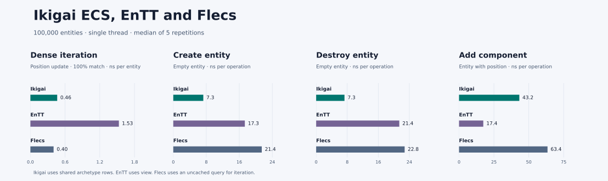

# Ikigai ECS, EnTT и Flecs

На 100 000 сущностей Ikigai тратит 7,1 нс на создание пустой сущности и 7,5 нс на её удаление. В плотном обновлении позиции Ikigai показывает 0,47 нс на сущность, EnTT — 1,39 нс, Flecs без кэша запросов — 0,42 нс.

В сравнении Ikigai запущен с экспериментальной раскладкой SharedRows и гибридным реестром сущностей. Для архетипных компонентов в ней требуется noexcept-перемещение и уничтожение. Все три ECS запускаются из одного Release-бинарника.

## Итерация

Во всех трёх ECS запрос ищет сущности с `Position` и `Velocity` и обновляет обе координаты позиции. Совпадения означают долю сущностей, у которых есть оба компонента. Сценарий с 16 наборами добавляет четыре тега в разных комбинациях. В столбце «Ikigai sparse» позиция хранится в архетипе, а скорость — в sparse-пуле. Для этой конфигурации замерены два сценария с фильтром. У Flecs позиция и скорость хранятся в архетипе.

Медианное время в наносекундах на совпавшую сущность. Меньше — быстрее.

| Сущности | Совпадения | Наборы | Ikigai | Ikigai sparse | EnTT | Flecs | Flecs с кэшем |
|---:|---:|---:|---:|---:|---:|---:|---:|
| 1 000 | 100% | 1 | 0,49 | — | 1,33 | 0,49 | 0,46 |
| 1 000 | 10% | 1 | 0,64 | 2,02 | 1,33 | 1,43 | 1,01 |
| 1 000 | 50% | 1 | 0,51 | 1,56 | 1,36 | 0,56 | 0,51 |
| 1 000 | 100% | 16 | 0,65 | — | 1,33 | 0,73 | 0,64 |
| 10 000 | 100% | 1 | 0,47 | — | 1,36 | 0,41 | 0,41 |
| 10 000 | 10% | 1 | 0,45 | 1,93 | 1,71 | 0,51 | 0,46 |
| 10 000 | 50% | 1 | 0,47 | 1,46 | 1,45 | 0,42 | 0,44 |
| 10 000 | 100% | 16 | 0,50 | — | 1,35 | 0,47 | 0,44 |
| 100 000 | 100% | 1 | 0,47 | — | 1,39 | 0,42 | 0,44 |
| 100 000 | 10% | 1 | 0,46 | 2,40 | 1,80 | 0,42 | 0,41 |
| 100 000 | 50% | 1 | 0,47 | 1,78 | 1,43 | 0,41 | 0,43 |
| 100 000 | 100% | 16 | 0,55 | — | 1,45 | 0,41 | 0,42 |

В Ikigai плотные запросы проходят по непрерывным участкам колонок. В смешанных сценариях ведущим оказывается sparse-пул скоростей. Если запрос содержит одну архетипную и одну sparse-колонку и подходит одна таблица, обе колонки выбираются один раз. Скорость читается из текущего чанка, а запись сущности даёт номер строки позиции. Запрос переиспользует страницу реестра для соседних ID.

В отдельной диагностике на 100 000 сущностей поиск записи по ID с чтением номера строки занимает 1,04 нс при 10% совпадений и 0,89 нс при 50%. Полный смешанный проход в том же прогоне занимает 2,43 и 1,60 нс на совпавшую сущность. Приведены медианы семи повторов.

## Структурные операции

Создание и удаление измеряются на пустых сущностях. В раздельных замерах добавления и снятия дополнительного компонента у сущности уже есть позиция. Целевое хранилище подготавливается вне таймера. В сценарии «цикл» к каждой сущности добавляется и сразу снимается компонент, а одна пара считается двумя операциями. Все числа в наносекундах на операцию.

| Сущности | Операция | Ikigai | EnTT | Flecs |
|---:|---|---:|---:|---:|
| 1 000 | Создать сущность | 8,1 | 19,6 | 23,9 |
| 1 000 | Удалить сущность | 9,5 | 22,2 | 26,4 |
| 1 000 | Добавить компонент | 56,5 | 18,6 | 72,8 |
| 1 000 | Снять компонент | 31,1 | 26,2 | 54,0 |
| 1 000 | Цикл добавления и снятия | 36,2 | 21,7 | 64,5 |
| 10 000 | Создать сущность | 6,7 | 17,9 | 21,4 |
| 10 000 | Удалить сущность | 7,9 | 21,7 | 24,5 |
| 10 000 | Добавить компонент | 56,1 | 17,8 | 68,9 |
| 10 000 | Снять компонент | 30,8 | 25,7 | 56,5 |
| 10 000 | Цикл добавления и снятия | 36,7 | 21,1 | 60,0 |
| 100 000 | Создать сущность | 7,1 | 17,6 | 24,6 |
| 100 000 | Удалить сущность | 7,5 | 22,0 | 23,1 |
| 100 000 | Добавить компонент | 57,4 | 18,0 | 64,4 |
| 100 000 | Снять компонент | 30,4 | 25,6 | 52,5 |
| 100 000 | Цикл добавления и снятия | 37,8 | 21,4 | 57,1 |

При смене состава сущности Ikigai переносит колонки по общему номеру строки и сохраняет поколения компонентов. В таблице у Ikigai измеряется публичный вызов добавления с возвратом handle.

## Реестр сущностей

Обычное создание использует страницы по 256 записей. Загруженные ID сохраняют свои значения. Разреженные записи хранятся в компактной таблице. Уже открытая страница или серия из восьми последовательных ID направляет новые записи в страничный индекс. Записи, уже добавленные в компактную таблицу, остаются на месте.

На 100 000 ID отдельная генерация занимает 3,6 нс на ID. Регистрация 100 000 заранее подготовленных последовательных ID через `World::registerEntity` занимает 3,7 нс на запись. Регистрация 1 000 разреженных ID с шагом 65 537 занимает 34,3 нс на запись. Это медианы отдельного прогона с семью повторами.

На тех же фикстурах прежняя страничная версия регистрировала разреженные ID в 23 раза медленнее. На 1 000, 10 000 и 100 000 обычных сущностей максимальный рост медианы создания или удаления составил 0,8%, в пределах разброса повторов.

Снимки занятых блоков кучи CRT на Windows показывают прирост памяти реестра. Пустой архетип и буфер ID готовы к первому снимку.

| Сценарий | Живые байты после вставки | После удаления всех сущностей |
|---|---:|---:|
| Регистрация 1 000 разреженных ID | 72 543 | 0 |
| Создание 100 000 последовательных ID | 3 222 624 | 2 056 |

Разреженная загрузка занимает в 142 раза меньше живой памяти, чем со страничным индексом. В сценарии с последовательными ID объём совпал с прежней версией. После удаления остаётся только корень страничного индекса.

## Рост целевого архетипа

В отдельной диагностике Ikigai переносит по 100 000 сущностей с 1, 4 или 8 существующими колонками. Перед измерением целевой архетип заполняется временными сущностями и очищается. Для сценария роста прогрев содержит одну строку, для повторного использования ёмкости он заполняет весь целевой архетип. Измеряемые сущности создаются после прогрева в одном порядке.

Медианное время в наносекундах на добавление для SharedRows.

| Сохраняемых колонок | С ростом | С подготовленной ёмкостью |
|---:|---:|---:|
| 1 | 56,4 | 55,3 |
| 4 | 108,4 | 80,8 |
| 8 | 213,9 | 122,6 |

## Как измеряли

- Замеры от 16 ноября 2026 года. Windows x64, AMD Ryzen 9 9950X, MSVC 19.38.33145, Release (`/O2 /Ob2 /DNDEBUG`), один поток. Tracy и трекинг памяти выключены.
- 99 сценариев, по пять повторов в одном запуске. В таблицах медианы wall time. В плотном сценарии на 100 000 сущностей коэффициент вариации составил 3,0% у Ikigai, 3,7% у EnTT и 5,6% у Flecs без кэша.
- EnTT использует `view`, созданный вне таймера. Flecs использует заранее созданный запрос с `QueryCacheNone` или `QueryCacheAuto`. Время Ikigai включает подбор архетипов в каждом вызове `forEach`. Проверка числа совпадений и значений, подготовка и очистка фикстур выполняются вне измеряемого участка.

[Версии библиотек и команды воспроизведения](README.md) · [Сравнительные бенчмарки abeimler/ecs_benchmark](https://github.com/abeimler/ecs_benchmark)
